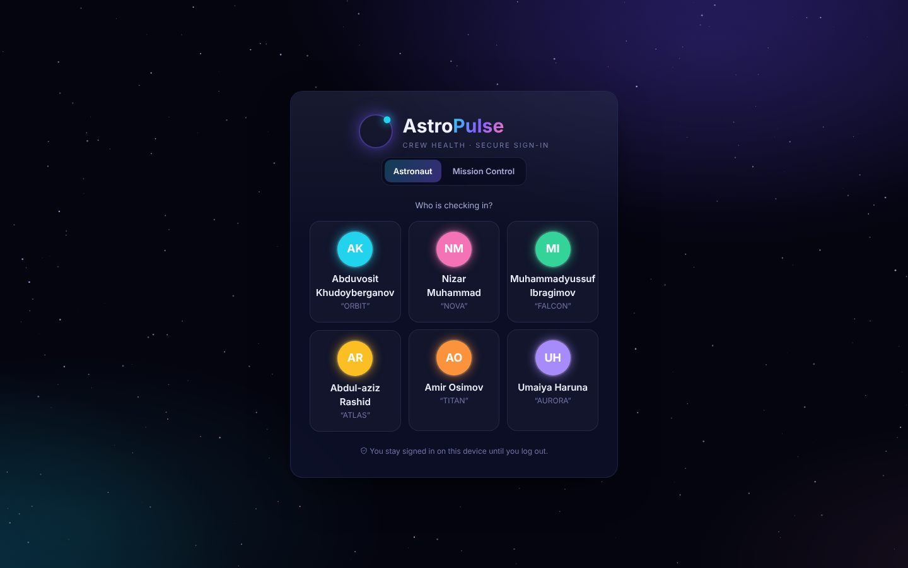
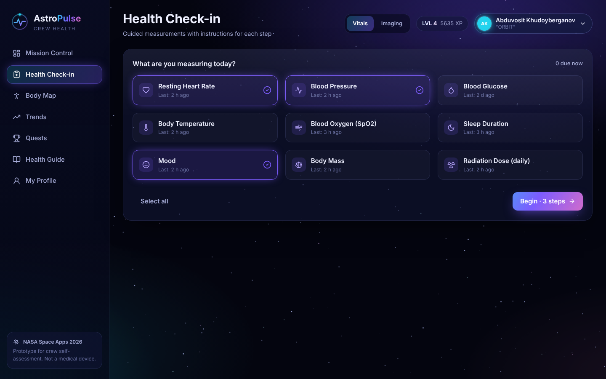
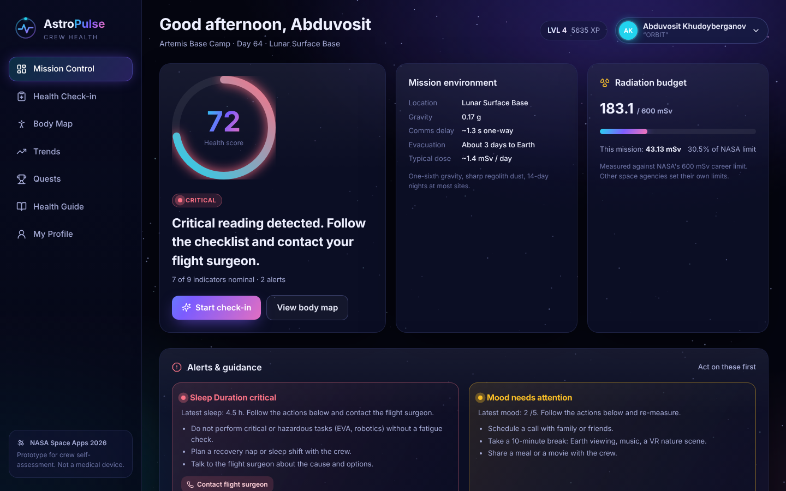
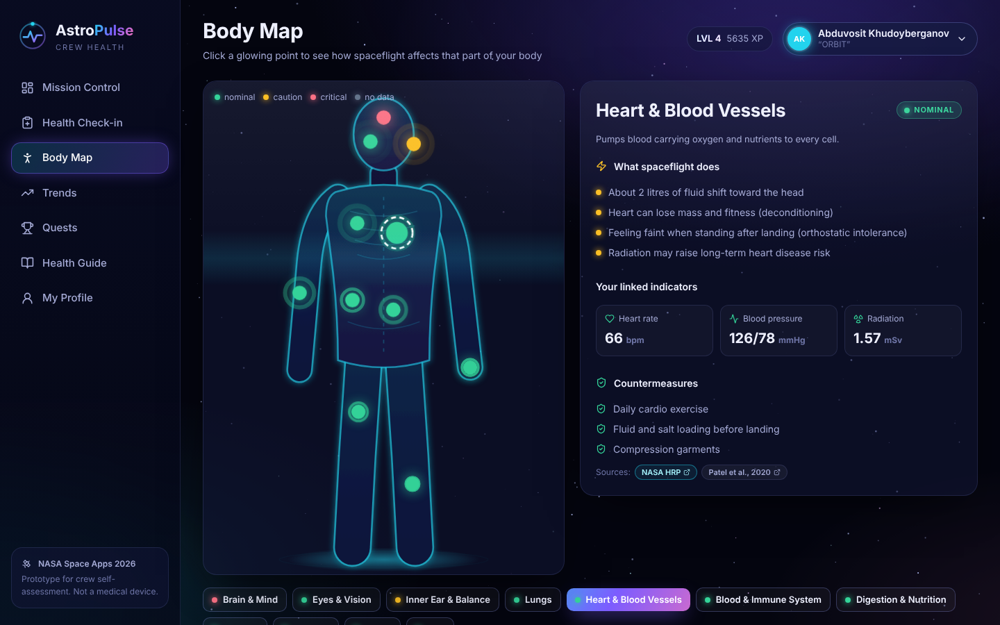
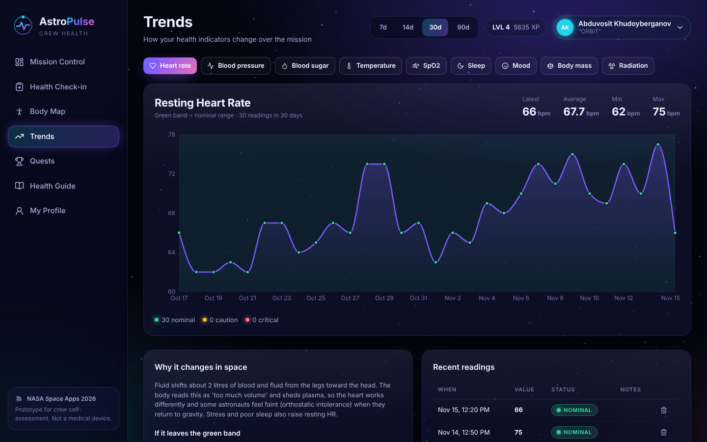
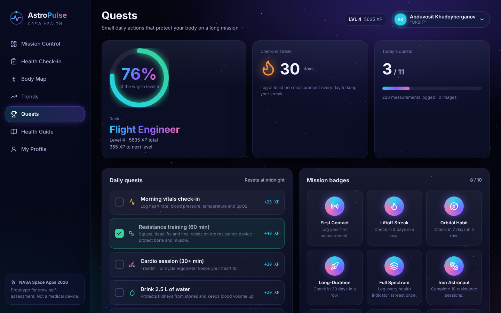
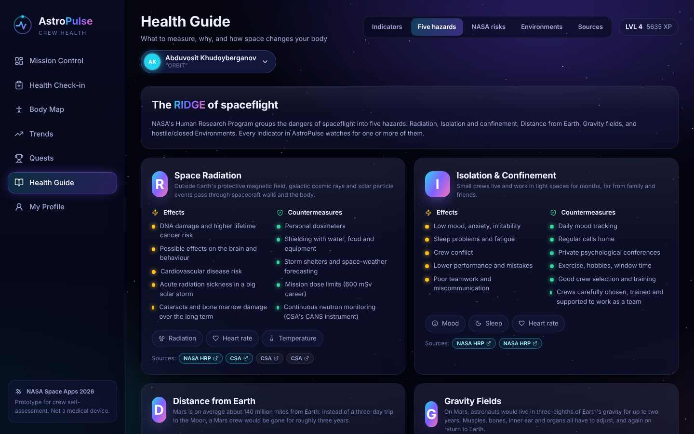
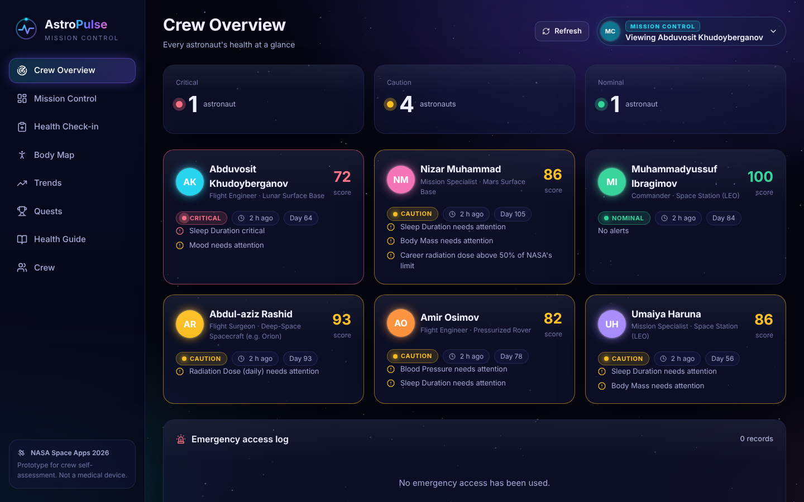

# AstroPulse: Astronaut Health Monitor

**Every heartbeat, mission-ready.**
NASA Space Apps Challenge 2026: *Create Health Monitoring Software for Astronauts on Space Missions*. Built by team **Qurutob**.

AstroPulse is a web app that lets astronauts track their own health in a 30-second daily check-in, and lets Mission Control watch the whole crew at once. It records nine health indicators, from heart rate to daily radiation dose. It compares each reading with clinical ranges and NASA limits, and turns the results into a health score and clear alerts. Every alert is linked to NASA's five hazards of human spaceflight, so crews learn *why* space causes the problem, not just *that* something is wrong.



> **Note:** the six crew members are our team. Their health readings are **simulated demo data**, not real medical data.

## Features

| | |
| --- | --- |
| **Health check-in.** Log 9 indicators: resting heart rate, blood pressure, blood glucose, body temperature, SpO2, sleep, mood, body mass and daily radiation dose. Upload health images (skin, eyes). |  |
| **Dashboard.** Health score 0–100, status (nominal / caution / critical), the astronaut's environment, career radiation against NASA's 600 mSv limit, and alerts with what to do next. |  |
| **Body map.** Click a body system to see how spaceflight affects it, the linked readings and the countermeasures. |  |
| **Trends.** Each indicator over 7, 14, 30 or 90 days against its normal band, with an explanation of why it changes in space. |  |
| **Quests.** 11 daily healthy-habit tasks (exercise, sleep, water, window time…) that earn XP, ranks and 10 badges. |  |
| **Health Guide.** The 9 indicators, NASA's five hazards, 17 NASA risks of human spaceflight (and which ones AstroPulse tracks), 5 environments, and 15 linked sources. |  |
| **Mission Control.** One screen with every crew member's score, status and alerts, plus the emergency access log. |  |

**Five environments:** space station (LEO), deep-space spacecraft (e.g. Orion), pressurized rover, lunar surface base and Mars surface base. Each has its own gravity, communication delay, radiation level and evacuation time.

## Privacy and logins

| Who | How to sign in | What they can see |
| --- | --- | --- |
| Astronaut | pick your name, type your 6-digit PIN | only your own record |
| Mission Control (admin) | username + password from `backend/.env` (default `admin` / `mission2026`, change it!) | every astronaut, Crew Overview, emergency access log |

- PINs and passwords are stored only as bcrypt hashes, never as text.
- The server enforces who can see what. The screen is not the only check.
- Astronauts stay signed in for 30 days, renewed on every visit, until they press **Log out**. Mission Control sessions last 12 hours.
- 5 wrong PINs lock the account for 5 minutes. Mission Control can reset a PIN, which logs out every device that used the old one.
- **Emergency access:** an astronaut can open a crewmate's record read-only for 60 minutes. A reason is required, and every use is logged for Mission Control and shown to the crewmate.
- Health images are served only to people allowed to see them. Profile photos are cropped in the browser to 256×256.

### Demo crew (after `python seed.py --reset`)

| PIN | Astronaut | Role | Location | Simulated health story |
| --- | --- | --- | --- | --- |
| 111111 | Abduvosit Khudoyberganov "ORBIT" | Flight Engineer, ESA | Lunar base | sleep and mood falling: critical |
| 222222 | Nizar Muhammad "NOVA" | Mission Specialist, JAXA | Mars base | high career radiation, weight loss |
| 333333 | Muhammadyussuf Ibragimov "FALCON" | Commander, NASA | Space station | healthy: nominal |
| 444444 | Abdul-aziz Rashid "ATLAS" | Flight Surgeon, CSA | Deep-space spacecraft | solar radiation event |
| 555555 | Amir Osimov "TITAN" | Flight Engineer, NASA | Pressurized rover | blood pressure rising |
| 666666 | Umaiya Haruna "AURORA" | Mission Specialist, ESA | Space station | losing body mass |

These are demo PINs for judging only.

## Run it locally (Linux)

You need Python 3.10+, Node.js 18+ and PostgreSQL.

```bash
# 1. Database (one time)
sudo -u postgres psql -c "CREATE USER astropulse WITH PASSWORD 'astropulse_pw';"
sudo -u postgres psql -c "CREATE DATABASE astropulse OWNER astropulse;"

# 2. Backend (terminal 1)
cd backend
python3 -m venv .venv
source .venv/bin/activate
pip install -r requirements.txt
cp .env.example .env
python seed.py --reset          # demo crew + 30 days of simulated data
uvicorn app.main:app --reload   # API docs: http://localhost:8000/docs

# 3. Frontend (terminal 2)
cd frontend
npm install
cp .env.example .env
npm run dev                     # open http://localhost:5173
```

Or, after step 1, use the helper scripts: `./start-backend.sh --seed` and `./start-frontend.sh`.

## Live online (free hosting)

AstroPulse runs 24/7 on free services: the website and API on [Render](https://render.com) and the database on [Neon](https://neon.tech). The free API sleeps after 15 quiet minutes, so the first visit after a break takes about a minute to wake it.

1. **Neon:** create a project (region: Frankfurt) and copy its connection string.
2. **Load the demo crew** into it from your computer:
   ```bash
   cd backend && source .venv/bin/activate
   DATABASE_URL='<Neon connection string>' python seed.py --reset
   ```
3. **Render:** New → Blueprint → pick this repo. Render reads `render.yaml` and asks for:
   - `DATABASE_URL`: the Neon connection string
   - `ADMIN_PASSWORD`: a new strong Mission Control password
   - `CORS_ORIGINS`: the website's address, e.g. `https://astropulse.onrender.com`
   - `VITE_API_URL`: the API's address, e.g. `https://astropulse-api.onrender.com`
4. Every `git push` updates the live site.

Uploaded photos and health images are stored in the database (table `stored_files`), because free hosting wipes its disk on restart.

## How it works

- **Frontend:** React 18 + Vite, Framer Motion (page transitions), Recharts (charts), Lucide (icons), React Router.
- **Backend:** Python FastAPI, SQLAlchemy 2, Pydantic, bcrypt, PyJWT.
- **Database:** PostgreSQL. Tables: astronauts, vital_readings, task_completions, health_images, admins, emergency_access.
- **Health engine** (`backend/app/health_engine.py`): checks each reading against its range, builds the score and alerts, and adds up mission and career radiation.
- **Knowledge base** (`backend/app/knowledge.py`): indicators, thresholds, the five hazards, body systems, environments, quests, badges, the 17 NASA risks and all sources.

```
astropulse/
├── backend/
│   ├── app/
│   │   ├── main.py           FastAPI app, CORS, routers, database upgrades
│   │   ├── security.py       hashing, sign-in tokens, permissions, lockout
│   │   ├── models.py         database tables
│   │   ├── knowledge.py      space-medicine knowledge and sources
│   │   ├── health_engine.py  health score, alerts, radiation, XP and badges
│   │   ├── storage.py        uploaded photos and images, kept in the database
│   │   └── routers/          auth, astronauts, vitals, health, images, photos
│   ├── seed.py               demo crew and simulated data
│   ├── schema.sql            the schema in plain SQL
│   └── requirements.txt
└── frontend/src/
    ├── App.jsx               routing and page transitions
    ├── components/           layout, starfield, UI kit, photo editor
    └── pages/                Login, Dashboard, CheckIn, BodyMap, Trends, Quests, Guide, Crew, Overview
```

## Space agency data and sources

- NASA: [5 Hazards of Human Spaceflight](https://www.nasa.gov/hrp/hazards), [Risks of Human Spaceflight](https://www.nasa.gov/hrp/risks), [Human Research Program](https://www.nasa.gov/hrp), [NASA-STD-3001 Radiation Protection brief](https://www.nasa.gov/wp-content/uploads/2023/03/radiation-protection-technical-brief-ochmo.pdf)
- Canadian Space Agency: [Monitoring radiation for astronaut health](https://www.asc-csa.gc.ca/eng/news/articles/2026/2026-02-26-monitoring-radiation-astronaut-health.asp), [How radiation affects the body in space](https://www.asc-csa.gc.ca/eng/astronauts/space-medicine/radiation.asp)
- Research on Mars risks, sleep, body temperature, space anemia and radiation on the Moon and Mars. The full list with links is in the app's **Health Guide → Sources** tab.

## Use of AI

We used Claude (Anthropic) as a coding and writing assistant. It helped write most of the code, the simulated demo data and this README. Our team chose the features, tested the app, checked the sources and made the final decisions.

---

*AstroPulse is an educational prototype. Normal ranges follow common clinical references and published NASA limits. It is not medical advice and not NASA flight rules.*
